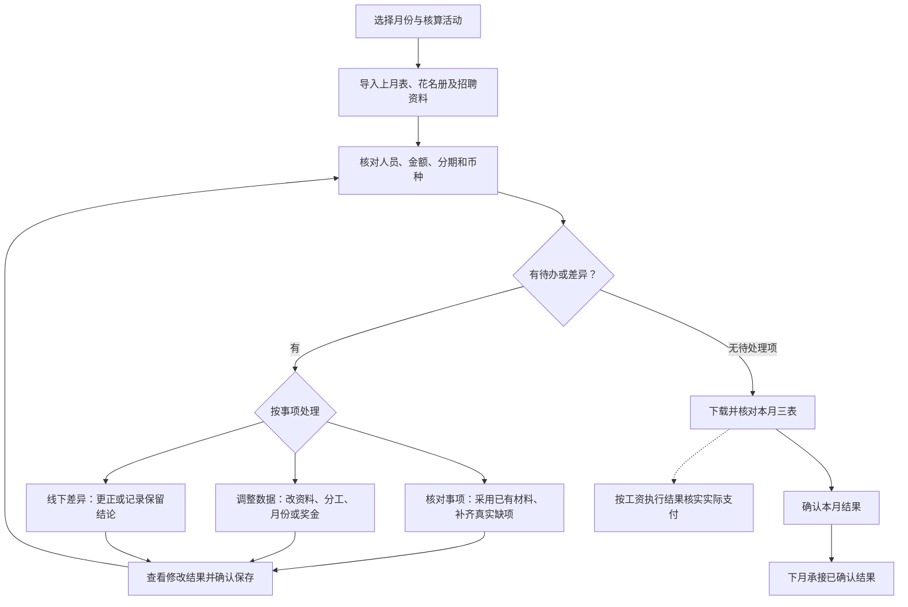

# 招聘奖金与内推奖金操作指引

版本：2026-10-20。适用当前平台。

按月度流程开始核算；遇到特殊事项，按问题查找操作。普通修改无需另填依据文件、页码和修改原因。

## 月度核算流程

## 常用事项入口

| 遇到的事项 | 查看操作 |
| --- | --- |
| 日期、职级、招聘渠道有误 | [修改入职、转正、离职、职级或渠道等资料](#facts) |
| 负责人、协助招聘人有变更 | [更换招聘负责人或协助招聘人](#assignment) |
| 推荐人或推荐关系有变更 | [更换推荐人或补充推荐关系](#recommender) |
| 一批人需要修改 | [多人修改为同一个值](#batch) |
| 奖金晚发、改月或恢复安排 | [将某一期奖金改到指定月份](#schedule) |
| 少发、多发，需要补扣 | [补发或扣回一笔确定金额](#supplement) |
| 离职或未转正，仍需发放 | [候选人或领取人离职、推荐人未转正，仍需发放](#qualification) |
| 本次确定不发奖金 | [确定某类奖金或某个角色不再发放](#exclude) |
| 体系外同事提供本月核定结果 | [导入体系外同事提供的本月核定结果](#external-results) |
| 与线下核算结果不一致 | [线下与平台不一致，需要改数据或发放安排](#handle-difference) |
| 操作失败或修改没有生效 | [保存了修改，本月金额仍未变化](#amount-unchanged) |

## 开始本月核算

### 01 新建本月核算活动

入口：**活动列表 → 新建核算活动**

1. 选择核算月份，在“活动名称”中填写名称；留空时按核算月份自动命名。
2. 如上月已有确认结果，在“承接上月结果（可选）”中选择对应活动；否则保留“自行导入上月表”。
3. 点击“创建并进入”，进入“导入资料”。

处理结果：本月资料和核算记录保存在该活动中。同月可有多个活动，进入前核对活动名称和月份。

相关操作：[接续上月尚未结清的奖金](#opening)、[首次使用，确实没有历史未结奖金](#no-opening)。

### 02 继续已有核算或切换核算记录

入口：**活动列表 → 进入核算；活动内标题旁 → 核算记录**

1. 在活动列表按名称、月份或状态查找，点击活动名称或“进入核算”。
2. 同一活动有多份核算记录时，点击“核算记录”，选择月度核算或指定的历史记录。
3. 查看页面月份和记录名称后继续操作。切换活动请使用“返回活动列表”。

处理结果：已保存的资料和修改继续保留。关闭页面不会完成月末确认。

相关操作：[确认本月核算结果](#confirm)、[改活动名称、归档和恢复活动](#archive)。

### 03 接续上月尚未结清的奖金

入口：**导入资料 → 上月核算表**

1. 新建活动时已选择上月确认结果的，等待资料整理完成，查看是否显示“已承接上月”。
2. 需要从线下迁入时，上传可信的上月核算表。点击“采用上月表”；有多份候选表时，只选择本次应承接的一份。
3. 点击“确认采用并更新核算”，返回明细核对历史人员、未结分期和原安排。

处理结果：上月核算表用于接续历史奖金。仅用于比较的“线下核对表”不作为上月基础。

历史已锁定的分期不能直接重排。若选错上月表，从核对事项或文件详情重新核对采用来源。

相关操作：[首次使用，确实没有历史未结奖金](#no-opening)、[上月确认结果后来发生变化](#parent-updated)、[将某一期奖金改到指定月份](#schedule)。

### 04 首次使用，确实没有历史未结奖金

入口：**导入资料 → 上月核算表 → 没有历史未结奖金**

1. 核实本次核算范围内没有往月未发完、暂缓或待补发的奖金。
2. 点击“没有历史未结奖金”，再点击“确认没有历史未结奖金”。
3. 导入本月花名册和招聘资料。

处理结果：本月从无历史未结奖金的基础开始核算。

存在历史未结奖金时，应导入上月核算表。

相关操作：[接续上月尚未结清的奖金](#opening)、[导入花名册、Offer、离职资料和特殊审批](#import)。

## 导入与补充资料

### 05 导入花名册、Offer、离职资料和特殊审批

入口：**导入资料 → 导入资料**

1. 选择本月花名册及招聘资料，可分次、多文件导入，也可拖入工作区。支持页面列出的 Excel、PDF 和图片格式。
2. 等待资料整理完成。平台按文件内容归入“本月花名册”“国内招聘资料”“海外 Offer”“离职与特殊审批”等分类。
3. 查看每份文件的状态；有读取失败或待处理提示时，打开文件核对。随后点击“查看核算明细”。

处理结果：识别到的资料用于匹配人员并更新核算；原文件保留。合并花名册能覆盖人员范围时，无需拆成固定份数。

文件已上传不等于人员已全部识别。同名文件不保证覆盖旧文件；相同内容重复上传也不会补出缺失资料。

相关操作：[查看原件、搜索工作表或下载文件](#source-preview)、[一批人员缺少录用信息](#missing-offer)、[文件读取失败、未识别或导入后没有新增人员](#file-error)。

### 06 导入体系外同事提供的本月核定结果

入口：**导入资料 → 体系外核算结果；调整数据 → 体系外核算结果；待办与差异 → 体系外结果事项**

1. 点击“下载模板”，填写被招聘人、奖金项目、领取人、本月核定金额和币种。奖金项目填写招聘负责人奖金、协助招聘人奖金或内推奖金。已有人员编号、入职日期和领取人编号可以一并提供。
2. 点击“上传结果”，选择本月表格。也可上传原核算台账，平台只提取标注体系外、GL 或已确认体系外范围的奖金项目。已有待采用预览时，点击“继续处理”，无需重新上传。
3. 核对预览中的人员、领取人、金额及按币种合计。出现同名或多次任职时，在该行选择对应任职；缺少金额等内容时，按工作表、行号和字段提示更正表格后重传。正常行不需要逐人审阅。
4. 点击“采用 N 项”，正常结果一次采用。尚未解决的行保留在“继续处理”中，关闭窗口后仍可从同一卡片继续。
5. 返回“核算明细”，核对“体系外线下核定”项目及招聘奖金、内推奖金汇总。更正结果时上传更正版，核对“更正后替换”记录后采用。

处理结果：本月采用已分配给实际领取人的核定金额，不再按招聘周期、比例或内部任职资料重算；同一项目不会与自动核算重复计奖。

金额空白表示缺项，0 表示明确不发。暂缓金额不计入本月发放合计。重复上传相同结果不会重复计奖；更正版替换本月对应项目，原件与版本保留。体系外范围和人员对应关系可承接至下月，仅提示本月应处理项目，不沿用上月金额。

相关操作：[误传资料，停用或恢复文件](#source-state)、[核对招聘奖金汇总和内推奖金汇总](#summary)、[开始下月，承接本月已确认结果](#carry-next)。

### 07 查看原件、搜索工作表或下载文件

入口：**导入资料 → 文件名**

1. Excel 文件可切换工作表、搜索姓名或工号，并翻页查看记录。PDF 或图片可查看原页。
2. 点击“下载原件”保存该文件。资料列表可在“列表”和“网格”两种显示方式间切换。
3. 需要查看同步详情、审批记录或文件参与状态时，展开文件预览中的“更多”。

处理结果：原件查询用于核实录用、任职和审批内容，不会修改核算。

相关操作：[更新国内招聘与任职资料](#domestic-sync)、[误传资料，停用或恢复文件](#source-state)、[识别审批调整，核对后采用](#approval)。

### 08 发现漏人，补充一名员工

入口：**导入资料 → 手动补充人员**

1. 先在“核算明细”切换“全部人员”，按姓名或工号搜索，确认不是筛选条件隐藏了该员工。
2. 确实未纳入时，点击“手动补充人员”，填写姓名；已知的工号、入职日期、招聘负责人工号一并填写。
3. 点击“保存人员”，再通过“调整数据 → 修改人员资料”补齐影响奖金的事实。多人遗漏时，补充花名册或录用名单后整批导入。

处理结果：新增人员进入核算记录；资料不完整的奖金仍需补充后才能确定。

候选人暂缺工号可以保存，不要编造工号。已有人员应修改原记录，避免重复新增。

相关操作：[修改入职、转正、离职、职级或渠道等资料](#facts)、[查不到员工、无工号、重复姓名或任职未匹配](#identity)。

### 09 更新国内招聘与任职资料

入口：**导入资料 → 国内招聘资料 → 更新国内资料**

1. 先导入本次需核算的花名册。平台按名单查询国内招聘和任职资料。
2. 源系统资料补齐后，点击“更新国内资料”，等待整理完成。
3. 打开同步文件，在“更多 → 同步详情”查看未返回资料的人员及具体缺项。补齐源系统资料后再次更新；局部补查会保留其他人员的有效资料。

处理结果：新的有效查询结果参与核算，历史同步记录仍可查看。

接口按已知名单查询，不会自动发现全月所有新增人员。“重新读取已上传资料”不等于重新查询国内接口。

相关操作：[同一招聘负责人、协助招聘人或推荐人影响多人](#shared-person)、[国内查询失败、查询无记录或返回资料不全](#sync-error)。

### 10 一批人员缺少录用信息

入口：**待办与差异 → 核对事项 → 对应的录用资料事项**

1. 打开事项，查看具体缺项。多项信息已有唯一参考值时，点击“带入表中已有信息”；也可逐项选择表中值，并查看来源单元格。
2. 已有内容核对后采用，无需再次上传。真正缺少的内容可上传录用资料，或下载补充表补齐后上传。
3. 国内人员可使用事项中的“接口补查”。只有少量字段需要修改时，点击该人员的“手工补充”，查看修改结果后保存。

处理结果：能够匹配的人员整批更新；尚缺资料的人员继续保留待办。

默认先处理影响本月的人员；后续月份人员可展开查看。不需要把花名册中已有字段重新填一遍。

相关操作：[不同资料中的日期、渠道或人员信息不一致](#conflict)、[查看后续月份需补的资料](#future)。

### 11 不同资料中的日期、渠道或人员信息不一致

入口：**待办与差异 → 核对事项 → 对应事项**

1. 打开事项，核对同一员工、同一次入职的原始资料。需要时展开“从原始资料选择”。
2. 选择正确来源值，或直接填写本次采用值。只修改已核实的字段。
3. 点击“查看修改结果”，核对受影响人员、本月金额及分期变化，再点击“确认保存”。

处理结果：平台保存采用值并重新核算；原始资料仍可查。未解决的缺项继续显示。

普通修改无需另填依据文件、页码和修改原因。周期剔除等专门业务字段仍按具体事项维护。

相关操作：[修改入职、转正、离职、职级或渠道等资料](#facts)、[招聘周期异常、负周期或需要剔除天数](#cycle)、[二次入职、内部调动或用工关系变更](#rehire)。

### 12 误传资料，停用或恢复文件

入口：**导入资料 → 文件名 → 更多**

1. 核对文件内容和当前参与状态，错误文件点击“停用”。需要重新使用的文件点击“恢复”。
2. 等待核算更新，再检查受影响的人员、待办和调整记录。
3. 已经作为上月基础的文件，应先核对正确的上月来源，不能按普通补充文件处理。

处理结果：停用保留原件和历史记录，但不再按有效资料使用；恢复后重新参与核算。

停用被审批或更正引用的资料，可能使相关事项转为待重新核对。

相关操作：[接续上月尚未结清的奖金](#opening)、[已做的补扣、例外或差异结论又提示需重核](#recheck-adjustment)。

## 查看核算结果

### 13 查看一名员工的奖金为什么这样计算

入口：**核算明细 → 员工姓名**

1. 按姓名或工号搜索，核对入职日期；有多次入职记录时选择本次任职。
2. 在“奖金明细”查看招聘奖金、内推奖金的适用规则、总额、币种、招聘周期及各期安排。
3. 在“员工资料”查看采用的事实；在“原始资料与修改记录”查看来源和更正。需调整时点击“调整数据”。

处理结果：可以对应到具体奖金、招聘负责人／协助招聘人／推荐人及发放月份。

相关操作：[区分零金额、待核金额和未安排奖金](#amount-state)、[修改入职、转正、离职、职级或渠道等资料](#facts)、[将某一期奖金改到指定月份](#schedule)。

### 14 核对招聘奖金汇总和内推奖金汇总

入口：**核算明细 → 招聘奖金汇总／内推奖金汇总**

1. 招聘奖金汇总按领取人及币种查看；内推奖金汇总按推荐人及币种查看。同一人领取不同币种奖金时分行列示，可搜索姓名或工号。
2. 核对本月各阶段金额、补发／扣回、待核金额和合计，按币种查看。
3. 清除搜索条件后查看完整汇总；需要追查某笔金额时返回核算明细查看员工分期。

处理结果：页面汇总与本月核算表使用同一份核算结果。

各币种分别合计，不自动换汇。

相关操作：[区分零金额、待核金额和未安排奖金](#amount-state)、[下载本月核算表](#export)、[币种不同，或明细与汇总看起来不一致](#currency)。

### 15 区分零金额、待核金额和未安排奖金

入口：**核算明细 → 员工姓名 → 奖金明细**

1. 金额为 0 时，查看不享受、资格不符、未到期、取消或暂缓等具体原因。
2. 显示“待核对”“待补充”或金额待定时，进入关联核对事项，先补齐影响计算的信息。
3. 有奖金总额但本月未安排时，查看对应分期的到期日、安排月份及资格。

处理结果：明确是规则计算为零、尚不能确定金额，还是奖金安排在其他月份。

待核不等于零，也不等于可以发放；尚未核实的金额不能当作已核对汇总。

相关操作：[按事项处理核对事项](#review-todo)、[将某一期奖金改到指定月份](#schedule)、[候选人或领取人离职、推荐人未转正，仍需发放](#qualification)。

### 16 查找人员、定位字段和调整表格显示

入口：**核算明细；调整数据 → 批量修改 → 在表格中编辑**

1. 日常明细可切换“本月核算人员”“需要核对的人员”“全部人员”，并通过字段组定位表格位置。
2. 进入完整明细后，可切换“核算明细”“完整台账”“各人分期”“人员与依据”“线下原表数据”等列视图。
3. “列设置”可勾选字段并保存视图，也可恢复默认。表头支持排序、拖动非固定列和调整列宽。
4. 日常明细和汇总的列边界可拖动，双击边界适配单列；点击“自动列宽”按当前页内容重排并清除本表手动列宽。内容被省略时，将鼠标停在该单元格查看完整显示值。

处理结果：仅改变当前浏览器的查看方式，不改变奖金，也不改变主导出文件的范围。

姓名、工号是固定列。“线下原表数据”需已有对应历史台账。

相关操作：[直接编辑表格或粘贴 Excel 区域](#grid)、[多人修改为同一个值](#batch)。

## 修改人员与招聘分工

### 17 修改入职、转正、离职、职级或渠道等资料

入口：**调整数据 → 修改人员资料**

1. 选择调整事项后搜索员工；也可先搜索员工，再选择“修改人员资料”。核对姓名、工号和入职日期。
2. 在“修改项目”中搜索要改的字段，填写“修改为”。多项更正点击“＋ 再改一项”；也可展开“按类别添加多项”。
3. 点击“查看修改结果”。确认字段、本月金额和涉及人员正确后，点击“确认保存”；需要修改则点击“返回修改”。

处理结果：更正自动保存并更新奖金，原值和修改记录保留。

将已填写字段改为空白属于清空；“移除”只移除本次要提交的修改项。规则计算金额应通过奖金调整处理，不直接覆盖。

相关操作：[更换招聘负责人或协助招聘人](#assignment)、[更换推荐人或补充推荐关系](#recommender)、[多人修改为同一个值](#batch)、[查修改记录，撤销或重做更正](#undo)。

### 18 更换招聘负责人或协助招聘人

入口：**调整数据 → 更换招聘负责人／协助人**

1. 选择候选人，分别搜索新的招聘负责人、协助招聘人，核对姓名和工号。
2. 确实没有协助招聘人时勾选“无协助招聘人”。需要从文件带入时，展开“从原始资料带入分工”，选文件并点击“带入分工”。
3. 点击“查看修改结果”，核对各人的分配金额及分期变化，再点击“确认保存”。

处理结果：招聘分工及相关奖金同步更新，修改可在记录中追查。

搜索不到人员时可以填写姓名和工号；缺少任职事实的，仍需补充对应资料。

相关操作：[批量更换招聘分工](#batch-assignment)、[同一招聘负责人、协助招聘人或推荐人影响多人](#shared-person)。

### 19 更换推荐人或补充推荐关系

入口：**调整数据 → 修改人员资料**

1. 选择候选人，修改“推荐人姓名”“推荐人工号”；多项修改可从“招聘与推荐关系”分类添加。
2. 按实际情况补充推荐人的任职、转正及上下级关系等字段。
3. 查看修改结果，核对内推奖金对应人员、资格及金额，再确认保存。

处理结果：内推奖金按照新的推荐关系和适用规则重新计算。

更换推荐人应修改推荐关系；仅需指定一笔补发的收款人时，使用补发／扣回中的“更换领取人”。

相关操作：[补发或扣回一笔确定金额](#supplement)、[候选人或领取人离职、推荐人未转正，仍需发放](#qualification)。

### 20 多人修改为同一个值

入口：**调整数据 → 批量修改 → 修改资料**

1. 搜索并勾选人员；“选择本页”只选择当前页。此选人窗口翻页或继续搜索会保留已选人员。
2. 点击“修改资料”，选择字段并填写统一采用值；支持一次修改多项。
3. 查看修改结果，逐项核对影响人数和金额，确认保存。

处理结果：只有实际填写的更改应用到所选人员；无更改的字段保留。

单次最多 500 人。不同人员需要不同值时，使用单独修改、表格编辑或 Excel 回传。

相关操作：[批量更换招聘分工](#batch-assignment)、[直接编辑表格或粘贴 Excel 区域](#grid)、[下载底稿，在 Excel 修改后回传](#excel)。

### 21 批量更换招聘分工

入口：**调整数据 → 批量修改 → 更换招聘分工**

1. 勾选需要调整的候选人。所有人改为同一分工时，点击“统一更正所选人员”。
2. 填写招聘负责人、协助招聘人后，点击“用于所选人员”；存在个别差异时，使用对应人员的“单独修改”。
3. 核对“原分工”和本次修改，点击“查看修改结果”，确认后保存。需要撤回未提交的单人更改可点“还原”。

处理结果：按每名候选人的分工更新相关奖金。

相关操作：[更换招聘负责人或协助招聘人](#assignment)、[查修改记录，撤销或重做更正](#undo)。

### 22 直接编辑表格或粘贴 Excel 区域

入口：**调整数据 → 批量修改 → 在表格中编辑 → 编辑资料**

1. 先选择人员范围、排序和列视图。进入“编辑资料”后，编辑可修改的事实字段；也可在完整明细中双击可编辑单元格。
2. 单格输入后按 Enter 或移开焦点；未提交的输入可按 Esc 恢复。需要预览时，核对后确认保存。
3. 粘贴时，从 Excel 复制不含表头的矩形区域，在对应起始格粘贴，核对预览后保存。完成后点击“查看奖金”。

处理结果：更新当前显示行列对应的人员事实。

粘贴按位置对应，不会按工号自动重排。不得超出当前页或可编辑列；跨页请分批。完整台账的翻页、搜索可能清除表格勾选，与批量选人窗口不同。

相关操作：[下载底稿，在 Excel 修改后回传](#excel)、[查找人员、定位字段和调整表格显示](#table-view)。

### 23 下载底稿，在 Excel 修改后回传

入口：**调整数据 → 用 Excel 修改**

1. 点击“下载可修改的底稿”，使用刚导出的 .xlsx 文件，在“可编辑底稿”工作表中修改事实值。
2. 保留任职标识、核算月份、底稿版本和字段列名。不要新增工作表、公式、未知人员或重复任职记录；空白值表示清空。
3. 保存文件，回平台点击“上传修改后的底稿”，检查回传差异和奖金变化，再确认保存。

处理结果：只有经过预览并保存的修改才应用到平台。

文件上限 30 MB。删掉 Excel 行不会删除平台人员。期间平台数据更新导致版本过期时，重新导出底稿；新增人员请走“手动补充人员”或名单导入。

相关操作：[提示资料已更新、预览失效或回传版本过期](#stale-version)、[发现漏人，补充一名员工](#missing-person)。

## 调整奖金与发放安排

### 24 将某一期奖金改到指定月份

入口：**调整数据 → 改发放月份／暂缓发放**

1. 选择员工，在奖金分期列表找到要调整的一期，点击“调整”。
2. “这笔奖金怎么发”选择“改到指定月份”，填写安排月份。
3. 点击“查看调整结果”，核对奖金、金额和原月份 → 新月份，点击“确认保存”。

处理结果：改变该期奖金的安排月份，金额仍按规则计算。

期初已锁定分期没有调整入口；资料、资格或到期条件不满足时，按提示先处理。改月份不能替代资格例外。

相关操作：[暂缓发放，或恢复原安排](#defer)、[候选人或领取人离职、推荐人未转正，仍需发放](#qualification)、[补发或扣回一笔确定金额](#supplement)。

### 25 暂缓发放，或恢复原安排

入口：**调整数据 → 改发放月份／暂缓发放 → 对应分期 → 调整**

1. 暂时不能安排时选择“暂缓发放”；需要取消已做的改期或暂缓时，选择“恢复原安排”。
2. 点击“查看调整结果”，核对受影响的奖金，再点击“确认保存”。
3. 返回人员明细查看最新安排。后续确定发放月份时，再改到指定月份。

处理结果：暂缓后该期不按当前月份安排；恢复原安排后重新按规则和当前资料判断。

恢复原安排不保证立即计入本月，仍取决于到期日和资格。

相关操作：[将某一期奖金改到指定月份](#schedule)、[确定某类奖金或某个角色不再发放](#exclude)。

### 26 补发或扣回一笔确定金额

入口：**调整数据 → 补发／扣回奖金**

1. 选择候选人、招聘奖金或内推奖金，在“怎么调整”中选择“补发”或“扣回”。
2. 金额填写正数，方向由“补发／扣回”决定。填写“计入哪月”和“发给谁”，核对自动带入的领取人姓名、工号和币种。
3. 需要时展开“更换领取人”；原奖金可选关联，不关联则作为单独补扣。点击“查看调整结果”，核对金额、领取人和月份后“确认保存”。

处理结果：补扣作为单独记录计入指定月份的核算汇总及导出。原规则标准和原分期保留。

这里填的是需要增加或扣减的金额，不是调整后的总额。例：应补 20 元，选“补发”并填 20；需扣 20 元，选“扣回”并填 20。币种沿用该类奖金，平台不自动换汇。

相关操作：[查看补扣、历史安排核对及资格例外记录](#special-records)、[币种不同，或明细与汇总看起来不一致](#currency)、[想确认奖金是否已经实际发放或扣回](#payment-status)。

### 27 候选人或领取人离职、推荐人未转正，仍需发放

入口：**调整数据 → 离职／未转正仍需发放**

1. 选择候选人及奖金类型，选中“哪笔奖金需要发放”。
2. 按本次确认的例外范围，勾选“允许候选人离职后发放”“允许领取人离职后发放”；内推奖金还可选“允许推荐人未转正时发放”。
3. 点击“查看调整结果”，核对本月金额和仍待处理的问题，再点击“确认保存”。

处理结果：例外只针对所选人员、奖金、分期、本月和勾选条件生效。

不会同时免除其他资格、资料缺项、到期限制或已取消状态。岗位、职级、上下级关系等没有通用豁免开关。

相关操作：[调整本月在职、转正的判断日期](#cutoff)、[没有适用奖金标准，或制度、岗位范围存在争议](#standard)、[已做的补扣、例外或差异结论又提示需重核](#recheck-adjustment)。

### 28 确定某类奖金或某个角色不再发放

入口：**调整数据 → 不发奖金**

1. 选择候选人及招聘奖金或内推奖金。
2. 招聘奖金可选择“全部招聘奖金”“只不发招聘负责人”或“只不发协助招聘人”；内推选择“全部内推奖金”。
3. 点击“查看调整结果”，核对取消范围及本月影响，再点击“确认保存”。

处理结果：保存该奖金或领取角色的取消决定，人员及历史资料继续保留。

只是晚发，请用“暂缓发放”。已经实际发出的款项需要扣回时，应单独登记扣回，不将取消决定当成已扣款。

相关操作：[暂缓发放，或恢复原安排](#defer)、[补发或扣回一笔确定金额](#supplement)、[查修改记录，撤销或重做更正](#undo)。

### 29 调整本月在职、转正的判断日期

入口：**记录与设置 → 本月设置 → 在职／转正看哪一天**

1. 选择要调整的奖金类型，查看当前采用的日期口径。
2. 选择“每笔奖金的到期日”“本月最后一天”或“指定日期”；指定日期时填写本月的具体日期。
3. 点击“查看调整结果”，核对受影响人员和金额，确认后保存。招聘奖金与内推奖金分别设置。

处理结果：本月该类奖金统一按所选日期判断在职、转正资格。

这项设置可能影响多人，不是单人例外；不自动延续到下月。单人特批请用“离职／未转正仍需发放”。

相关操作：[候选人或领取人离职、推荐人未转正，仍需发放](#qualification)、[查看补扣、历史安排核对及资格例外记录](#special-records)。

### 30 查看补扣、历史安排核对及资格例外记录

入口：**待办与差异 → 处理记录 → 奖金调整记录**

1. 进入处理记录，可搜索人员或记录内容，查看相关审批、原件和涉及人员。
2. 点击“查看调整记录”或页面中的“奖金调整记录”，查看已采用、已撤销或待重新核对的安排。
3. 需要新增时点击“新增调整”；需要取消已有安排时点击“撤销并重算”，核对影响后“确认撤销”。

处理结果：调整记录保留处理经过，撤销后金额重新计算。

该调整清单列出补扣、历史安排核对、资格例外和日期口径。不发奖金、人员事实和分期安排也可从“修改记录”及人员明细查看。

相关操作：[已做的补扣、例外或差异结论又提示需重核](#recheck-adjustment)、[查修改记录，撤销或重做更正](#undo)、[想确认奖金是否已经实际发放或扣回](#payment-status)。

## 处理核对事项与审批

### 31 按事项处理核对事项

入口：**待办与差异 → 核对事项**

1. 按“待补资料”“已有材料待核”“事实核对”“历史差额”“制度核定”查看事项。本月影响和后续跟进分别列示。
2. 点击事项右侧按钮。已有材料直接核对采用，事实有误只改对应字段，真正缺少的内容再补充。
3. 修改后查看结果并确认保存。返回待办，必要时点击“刷新进度”，确认事项是否已解决。

处理结果：同一原因形成的集中事项可影响多人；待办类数不是异常人数，也不等于线下差异笔数。

相关操作：[一批人员缺少录用信息](#missing-offer)、[同一招聘负责人、协助招聘人或推荐人影响多人](#shared-person)、[识别审批调整，核对后采用](#approval)、[查看后续月份需补的资料](#future)。

### 32 同一招聘负责人、协助招聘人或推荐人影响多人

入口：**待办与差异 → 核对事项 → 对应任职资料事项**

1. 打开事项，查看“影响多少名员工的奖金”和已查询结果。
2. 需要批量补齐时，点击“上传任职资料，匹配整批”；尚未查询的国内人员可使用“补查尚未查询的国内人员”。
3. 手工补充同一人、同一次任职的共用字段时，查看结果中的全部影响人员，确认后保存。

处理结果：共同任职信息按关联范围统一更新，无需在每名候选人处重复修改。

不同任职段不能共用转正日期或最后工作日。查询无记录不代表可以默认在职或已转正。

相关操作：[二次入职、内部调动或用工关系变更](#rehire)、[国内查询失败、查询无记录或返回资料不全](#sync-error)。

### 33 查看后续月份需补的资料

入口：**待办与差异 → 核对事项 → 后续月份的资料**

1. 展开后续月份事项，查看涉及人员、分期和缺项。
2. 已有资料可提前补齐；尚未取得的资料，待实际形成后再更新。
3. 下月开始时重新查看待办，确认到期奖金的资料已完整。

处理结果：这部分事项不影响当前月份，但可能影响后续到期奖金。

相关操作：[开始下月，承接本月已确认结果](#carry-next)、[按事项处理核对事项](#review-todo)。

### 34 识别审批调整，核对后采用

入口：**导入资料 → 离职与特殊审批 → 核对审批调整；或核对事项 → 查看审批**

1. 上传审批 PDF 或图片后，打开“核对审批调整”，查看人员、调整项目、当前值和采用值。多份审批在同一清单处理。
2. 按需展开“查看审批原件”，核对最终批准内容。同一审批涉及多人的，分别列出；识别值有误时直接修改，人员不唯一时点击“选择人员”。
3. 勾选需要处理的事项，点击“核对并采用”。原资料已正确时，点击该人员卡片上的“已核对，无需调整”。需要先看金额时，点击“查看奖金影响”。

处理结果：所选调整一次保存并更新核算，系统自动保留审批原件、页面及修改记录，可整体撤销。

处理只对已核对的人员和当前资料生效；相关资料变化后会重新提示核对。

相关操作：[审批缺附件，或涉及人员不在核算名单](#approval-attachments)、[修正识别结果，按审批调整资料](#approval-edit)、[查修改记录，撤销或重做更正](#undo)。

### 35 审批缺附件，或涉及人员不在核算名单

入口：**审批调整 → 对应事项的缺项提示**

1. 缺少审批引用附件时，提示会列出文件名；点击“补充资料”导入，系统自动对应已上传附件。
2. 以前月份入职的人员尚未纳入核算时，先导入或承接上月核算表；本月新人员缺失时补充花名册。
3. 同名人员或多次任职无法唯一对应时，点击“选择人员”，按工号和入职日期选定。返回清单核对后采用。

处理结果：只补充实际缺少的资料，无须手工勾选关联文件或填写引用范围。

有缺项的事项保留待处理，可先采用其他已核对的事项。

相关操作：[修正识别结果，按审批调整资料](#approval-edit)、[接续上月尚未结清的奖金](#opening)、[审批未通过、缺附件或原件无法识别](#approval-error)。

### 36 修正识别结果，按审批调整资料

入口：**审批调整 → 采用值／选择人员／补充调整项**

1. 核对“采用值”。审批缺少实际招聘渠道，而已上传核对表有明确值时，可在同一审批项选择该来源，不必再传一份相同资料。
2. 未识别完整时，选择人员并使用“补充调整项”填写实际调整字段。姓名和工号需要对应，清空原角色时同时核对姓名与工号。
3. 勾选需要采用的事项，点击“核对并采用”。同一字段的多份审批有不同值时，先核实最终有效审批。

处理结果：修改内容、人员和原件一并留存，不再单独填写审阅状态、页码或审阅说明。

补发、扣回、发放安排和资格例外仍从“调整数据”进入相应业务操作。

相关操作：[补发或扣回一笔确定金额](#supplement)、[候选人或领取人离职、推荐人未转正，仍需发放](#qualification)、[确定某类奖金或某个角色不再发放](#exclude)。

## 核对线下差异

### 37 导入线下结果，查看本月差异

入口：**待办与差异 → 线下差异 → 添加核对结果**

1. 上传本月用于比较的 .xlsx 或 .xlsm 结果表，在“核对台账”选择文件。未提供本月核对表时显示“尚未比较”，不产生漏列差异。
2. 按“待处理”“全部差异”“已确认保留”“需重新核对”筛选，或搜索姓名、工号。
3. 逐笔核对金额、月份、币种、领取人、角色及资格；在名单差异中分别查看两侧未对应人员，沿关联事项处理。

处理结果：比较表不会自动覆盖核算。明确的岗位类别、实际渠道、招聘启动日及招聘负责人可在原资料或审批表单核对后采用。

相关操作：[线下与平台不一致，需要改数据或发放安排](#handle-difference)、[核对后确认平台正确，保留当前差异](#retain-difference)、[核对全历史、采用字段和任职对应，导出差异](#deep-compare)。

### 38 核对历史安排与当前规则的金额差额

入口：**待办与差异 → 核对事项 → 历史奖金差额 → 处理**

1. 先查看原表备注、来源单元格和已有调整记录，再核对原安排、当前规则、币种和领取人。原表写有扣回时，先核实是否已处理。
2. 原历史安排需要保留时，选择“认可历史安排”，查看结果后保存；该结论不改变规则金额，也不表示已发薪。
3. 确需补发或扣回时，打开原调整表单，核对金额、月份和领取人后保存。原表已有扣回说明时不再默认填入扣款金额；旧领取人不明时先核实。

处理结果：核对结论、补扣安排和原历史分期分别保留。相关金额或资料变化后，需要重新核对。

实际发薪及扣款结果仍以工资执行记录为准。需要撤销时，从奖金调整记录撤销对应安排。

相关操作：[补发或扣回一笔确定金额](#supplement)、[查看补扣、历史安排核对及资格例外记录](#special-records)、[想确认奖金是否已经实际发放或扣回](#payment-status)。

### 39 线下与平台不一致，需要改数据或发放安排

入口：**待办与差异 → 线下差异 → 对应差异 → 处理**

1. 查看差异原因和线下备注，先确认是否为同一员工、同次任职、同类奖金和同一期。
2. 月份不同点“改发放月份”；事实或人员有误点“调整这位员工的数据”；存在关联核对事项时从相应入口补齐。
3. 查看修改结果并保存，返回“线下差异”刷新进度，核对最新金额和月份。

处理结果：资料或安排修正后重新比较；仍不一致的差异继续保留。

不要直接把“线下金额 − 平台金额”填成补发。先查明事实、规则、资格、币种和分期；确有明确补扣事项再登记补扣。

相关操作：[补发或扣回一笔确定金额](#supplement)、[查不到员工、无工号、重复姓名或任职未匹配](#identity)、[币种不同，或明细与汇总看起来不一致](#currency)。

### 40 核对后确认平台正确，保留当前差异

入口：**线下差异 → 处理 → 记录核对结论**

1. 核实差异原因及当前核算结果，选择“已核对，保留当前差异”。尚未查清时选择“待继续核对”。
2. 点击“确认保存结论”。无需另填说明或选择依据文件。
3. 可切换“已确认保留”查看已处理项目；后续资料、金额或安排变化后，重新检查“需重新核对”。

处理结果：只记录差异处理结论，不修改奖金金额。差异仍可在“全部差异”和历史记录中查到。

线下差异进度与核对事项分别统计。不能用“本月已确认”代替逐笔差异核对。

相关操作：[核对全历史、采用字段和任职对应，导出差异](#deep-compare)、[确认本月核算结果](#confirm)。

### 41 核对全历史、采用字段和任职对应，导出差异

入口：**待办与差异 → 线下差异 → 全历史与字段核对**

1. “核对内容”可选“本月发放安排”“全历史规则试算”“采用字段”“任职对应”。
2. 按“数值不同”“无法试算”“发放月份不同”“币种不同”等筛选；展开“核对口径”查看比较范围。
3. 从差异行查看分期与依据或修改事实；需要带走结果时点击“导出完整差异”。规则问题可点击“查看规则问题”继续核对。

处理结果：完整差异导出包含全部差异，不限于当前页。

金额一致不代表身份、资料和实际支付均已核实。

相关操作：[查看规则检查提示](#rule-check)、[币种不同，或明细与汇总看起来不一致](#currency)。

## 导出、确认与下月承接

### 42 下载本月核算表

入口：**核算明细 → 导出与完成 → 下载本月核算表**

1. 核对当前活动、月份和核算记录，等待资料整理及修改保存完成。
2. 点击“下载本月核算表”，取得招聘明细、招聘汇总和内推汇总三张工作表。
3. 核对人员范围、各角色金额、补发／扣回及分币种合计。若之后又改了数据，重新下载。

处理结果：文件按当前核算记录的本月范围导出，不是当前搜索结果或当前页。

三表名称为“附件一-招聘奖金核算明细”“附件二-招聘奖金汇总表”“附件三-内推奖金汇总”。有待核项时可先下载核对，但不能据此认定已完成核算或支付。

相关操作：[确认本月核算结果](#confirm)、[下载核算依据、原始底稿或可修改底稿](#other-export)、[想确认奖金是否已经实际发放或扣回](#payment-status)。

### 43 下载核算依据、原始底稿或可修改底稿

入口：**导出与完成 → 其他导出；记录与设置 → 本月设置 → 资料与规则工具**

1. “下载核算依据”用于复核完整计算、分期和来源；不是 Excel 回传模板。工具中的“导出完整核算底稿”为同类完整核算导出。
2. “下载可修改的底稿”用于改事实后回传，操作见“用 Excel 修改”。
3. 工具中的“导出原始底稿”用于带走底稿记录、集中待办、人工更正和资料清单；单份原文件从文件详情下载。

处理结果：按用途选择文件，避免把核算结果表或依据文件当成可回传模板。

“导出原始底稿”不是全部上传附件的压缩包。

相关操作：[下载底稿，在 Excel 修改后回传](#excel)、[查看原件、搜索工作表或下载文件](#source-preview)、[核对全历史、采用字段和任职对应，导出差异](#deep-compare)。

### 44 确认本月核算结果

入口：**核算明细 → 导出与完成 → 确认本月结果**

1. 先核对人员和资料覆盖范围、核对事项、线下差异处理情况及导出三表。
2. 点击“确认本月结果”，查看月份、人数和金额，再点击窗口内的“确认本月结果”。
3. 若出现“本月还有待处理事项”，点击“去处理”，补齐对应资料或更新上月基础后再确认。

处理结果：本次确认结果可供下月承接。确认后再次修改，需核对最新版本并重新确认。

系统会检查本月资料问题、同步覆盖、导入错误、上月基础及人员等条件；线下差异仍需业务单独核对。核算确认不代表款项已支付。

相关操作：[开始下月，承接本月已确认结果](#carry-next)、[想确认奖金是否已经实际发放或扣回](#payment-status)、[核对后确认平台正确，保留当前差异](#retain-difference)。

### 45 重新读取资料，或另建一份核算

入口：**记录与设置 → 本月设置**

1. 仅需用当前已保存文件重新整理计算，点击“重新读取已上传资料”。需要重新查询国内源系统时，应使用“更新国内资料”。
2. 需要保留现有记录、另做一份核算时，点击“另建一份核算”，按页面提示创建并导入资料。活动内月份固定。
3. 新记录核对完成后，从“导出与完成 → 确认本月结果”比较新旧人数和分币种金额，点击“采用并确认本月核算”。

处理结果：采用前可查看新旧差异；采用后新记录成为本月结果，原记录保留。

另建记录不是简单更名或修改月份。进入后需检查资料是否齐全，不假定原本月文件已全部复制。

相关操作：[继续已有核算或切换核算记录](#continue)、[上月确认结果后来发生变化](#parent-updated)、[确认本月核算结果](#confirm)。

### 46 开始下月，承接本月已确认结果

入口：**活动列表 → 新建核算活动 → 选择下月**

1. 先在本月完成结果确认。
2. 新建下月活动，在“承接上月结果（可选）”选择本月对应活动，创建并进入。
3. 等待承接完成，导入下月花名册和招聘资料，核对未结分期、暂缓和后续补扣安排。

处理结果：已确认分期的金额、币种、领取人和月份保留；下月按最新资料核算未结分期，后续核对事项随实际到期情况处理。

选择下月活动时核对来源，不将同月另一核算范围的活动误作上月基础。

相关操作：[上月确认结果后来发生变化](#parent-updated)、[查看后续月份需补的资料](#future)。

### 47 上月确认结果后来发生变化

入口：**页面“上月核算结果已更新”提示 → 重新核算**

1. 先核对上月更正内容及最新确认版本。
2. 在本月提示处点击“重新核算”，带入最新上月结果，补充并核对本月资料。
3. 比较新旧结果后采用并确认；如后续月份已开始，再检查其上月基础是否也需更新。

处理结果：已开始的本月记录不会被悄悄覆盖；通过新核算记录承接最新基础。

相关操作：[重新读取资料，或另建一份核算](#recalculate)、[确认本月核算结果](#confirm)。

## 记录、撤销与活动管理

### 48 查修改记录，撤销或重做更正

入口：**记录与设置 → 修改记录**

1. 查看原值、修改后的值、时间和已撤销状态；单人来源也可从人员详情查看。
2. 撤销最近一次操作，点击“撤销上次更正”；恢复刚撤销的操作，点击“重做”。
3. 返回核算明细检查金额和待办。补扣、资格例外或日期设置也可从奖金调整记录撤销指定安排。

处理结果：按一次操作整体撤销并重新计算；新增更正后，原可重做队列会清空。

上传文件、采用上月表、补充人员等不一定属于可撤销更正；应使用各自的资料状态或来源入口处理。

相关操作：[查看补扣、历史安排核对及资格例外记录](#special-records)、[误传资料，停用或恢复文件](#source-state)。

### 49 查看审批、差异与奖金的处理经过

入口：**待办与差异 → 处理记录；或记录与设置 → 奖金调整记录**

1. 按姓名或记录内容搜索，查看处理类型、状态、时间及关联人员。
2. 通过“查看审批”“查看原始依据”“查看调整记录”进入对应记录。
3. 金额、事实或引用资料变化后，关注“待重新核对”及具体原因，再按当前资料处理。

处理结果：可串起资料、审批、人工调整和线下差异的处理经过。

这里不是所有后台活动的完整日志；实际支付状态另行核实。

相关操作：[已做的补扣、例外或差异结论又提示需重核](#recheck-adjustment)、[想确认奖金是否已经实际发放或扣回](#payment-status)。

### 50 改活动名称、归档和恢复活动

入口：**活动列表 → 对应活动右侧“…”**

1. 需要更名时修改“活动名称”，点击“保存名称”。
2. 无需继续编辑的活动点击“归档活动”。归档后资料和结果保留，只可查看。
3. 需要继续核算时，在状态中选择“已归档”，打开管理窗口并点击“恢复活动”。

处理结果：活动归档可恢复，不删除记录，也不代表奖金已经支付。

相关操作：[继续已有核算或切换核算记录](#continue)、[想确认奖金是否已经实际发放或扣回](#payment-status)。

### 51 查询原核算记录和低频工具

入口：**活动列表 → 原核算记录；记录与设置 → 本月设置 → 资料与规则工具**

1. 旧月度记录从活动列表的“原核算记录”查找；当前活动内的重算记录从标题旁“核算记录”查看。
2. 低频工具保留完整底稿导出、可编辑底稿回传、原始底稿导出、资料和规则等入口。操作后点击“返回本月工作”。
3. 日常上月接续使用新建活动时的“承接上月结果”，不要用旧工具中的“承接上月”代替已确认版本选择。

处理结果：原记录与当前核算活动分别保留，可按来源查询。

工具中的旧“历史批次”属于另一套流程，本地预览未接入其旧接口；不要在那里新建或确认本月核算。

相关操作：[查看规则检查提示](#rule-check)、[下载核算依据、原始底稿或可修改底稿](#other-export)、[开始下月，承接本月已确认结果](#carry-next)。

## 异常情况处理

### 52 查不到员工、无工号、重复姓名或任职未匹配

入口：**核算明细 → 全部人员；待办与差异 → 关联事项**

1. 先清除搜索和人员范围限制，确认活动、月份及核算记录。
2. 核对姓名、工号、入职日期和 Offer 关联信息。缺工号本身不阻碍候选人核算；存在身份冲突时才补相应标识。
3. 同名、重复任职或线下人员无法匹配时，核对原始名单并更正关联信息；确实漏人再补充人员。无法辨明时保留待核，交招聘或人事经办人确认。

处理结果：先确认核算对象，再处理金额。

候选人可以暂缺工号；补发／扣回的实际领取人仍需姓名和工号，二者不能混为一谈。

相关操作：[发现漏人，补充一名员工](#missing-person)、[二次入职、内部调动或用工关系变更](#rehire)、[修改入职、转正、离职、职级或渠道等资料](#facts)。

### 53 二次入职、内部调动或用工关系变更

入口：**待办与差异 → 对应任职事项；调整数据 → 修改人员资料**

1. 在同一任职核对表单确认是离职后重新入职，还是原任职延续，不必分别处理重复日期事项。
2. 前次离职记录唯一且有效时，平台带出日期和来源，无需重填。缺少或存在多条记录时，只补充实际未明确的内容；确有制度冲突再核定口径。
3. 查看结果中的适用规则、招聘周期和分期，确认正确后保存。

处理结果：以本次任职及已核实的关系判断奖金，历史任职信息保留。

上次任职的转正日期不能代作本次转正日期；不要仅凭系统出现新日期就新增一条奖金。

相关操作：[招聘周期异常、负周期或需要剔除天数](#cycle)、[修改入职、转正、离职、职级或渠道等资料](#facts)、[没有适用奖金标准，或制度、岗位范围存在争议](#standard)。

### 54 招聘周期异常、负周期或需要剔除天数

入口：**待办与差异 → 对应周期事项；调整数据 → 修改人员资料**

1. 先核对招聘启动日期、实际入职日期和原计划入职日期。出现负周期时，核实是否关联了错误的招聘需求或入职记录。
2. 日期确需更正时改事实；制度允许周期剔除、豁免或延期处理时，再填写对应天数、资格和业务依据字段。
3. 查看修改后的招聘周期、适用标准和奖金；尚无明确业务口径的，保留待核并交制度维护人员确认。

处理结果：周期重新按事实及适用口径计算。

周期剔除、负周期确认、管培生资格等是业务判断字段，不要为对齐线下金额任意填写。

相关操作：[修改入职、转正、离职、职级或渠道等资料](#facts)、[没有适用奖金标准，或制度、岗位范围存在争议](#standard)。

### 55 没有适用奖金标准，或制度、岗位范围存在争议

入口：**待办与差异 → 制度核定 → 对应事项**

1. 核对入职日期、岗位类别（ABC）、职级、地区类型、标签分类和招聘渠道是否准确。
2. 事实有误的，先修改资料并重新核算。事实正确但缺标准或规则不支持的，交制度维护人员核实适用制度并维护。
3. 维护完成后重新核算；明确批准为固定补扣金额的个案，按补发／扣回办理。

处理结果：资料错误通过更正解决；制度缺口通过规则维护解决。

平台没有通用制度参数编辑器。不能用资格例外绕过岗位、职级、渠道或上下级关系规则。

相关操作：[查看规则检查提示](#rule-check)、[候选人或领取人离职、推荐人未转正，仍需发放](#qualification)、[补发或扣回一笔确定金额](#supplement)。

### 56 查看规则检查提示

入口：**线下差异 → 全历史与字段核对 → 查看规则问题**

1. 选择“本月已安排”“本月入职”或“全部台账”，查看问题人员和原因。
2. 点击“查看资料与计算”，核对事实及适用规则。需要修改时使用资料更正或对应奖金调整入口。
3. 事实齐全但仍无适用标准时，提交制度维护人员处理，再重新核算。

处理结果：规则检查用于定位计算条件问题，不直接修改制度。

原草稿中“尚未通过独立试算验收”等提示应结合记录来源理解，不能当作当前月所有奖金均可发放的证明。

相关操作：[没有适用奖金标准，或制度、岗位范围存在争议](#standard)、[重新读取资料，或另建一份核算](#recalculate)。

### 57 币种不同，或明细与汇总看起来不一致

入口：**核算明细 → 员工姓名 → 奖金明细；线下差异 → 全历史与字段核对**

1. 分别核对招聘奖金和内推奖金的标准币种、地区及适用规则，再核对对应月份、领取人和分期。
2. 分别查看各币种合计，以及是否存在待核金额、补扣或暂缓。工作地与组织资料矛盾时，在核对事项中核对实际所属地区。
3. 事实有误则修改对应资料；事实正确但金额依据不明时保留差异并核实制度口径。

处理结果：在相同奖金、币种、人员、分期和月份范围内比较。

平台不提供自动换汇；不能将不同币种的差额直接登记为补扣。

相关操作：[核对招聘奖金汇总和内推奖金汇总](#summary)、[线下与平台不一致，需要改数据或发放安排](#handle-difference)、[没有适用奖金标准，或制度、岗位范围存在争议](#standard)。

### 58 文件读取失败、未识别或导入后没有新增人员

入口：**导入资料 → 对应文件**

1. 查看文件状态、工作表和记录内容，确认上传的是原始名单或录用资料，而不是仅供比较的结果表。
2. 检查是否有正确表头、有效数据、对应月份及匹配标识；修正原文件后再上传。需要时先在 Excel 中重新保存损坏或公式结果缺失的文件。
3. 切换“全部人员”检查是否已匹配到已有员工；确实未覆盖的人员补充名单，不反复上传相同错误文件。

处理结果：已保存原件仍可查，只有成功识别且匹配的内容才能形成核算资料。

相关操作：[误传资料，停用或恢复文件](#source-state)、[查不到员工、无工号、重复姓名或任职未匹配](#identity)、[资料月份或活动月份选错](#wrong-month)。

### 59 资料月份或活动月份选错

入口：**页面月份提示／活动列表**

1. 核对资料实际覆盖月份，文件下载日期不一定是核算月份。
2. 页面提供“按资料月份核算”时，可按提示处理；活动或独立重算记录月份固定的，回活动列表进入或新建正确月份。
3. 在错误活动中误传的文件按资料状态停用；在正确活动重新导入并核对。

处理结果：资料归入正确核算范围后再处理人员和金额。

相关操作：[新建本月核算活动](#new-activity)、[误传资料，停用或恢复文件](#source-state)。

### 60 审批未通过、缺附件或原件无法识别

入口：**审批调整 → 对应缺项提示**

1. 审批明确显示未结束、已撤回或已驳回时，补充最终通过的审批原件后再处理。
2. 缺附件时按提示文件名导入；未识别出人员或调整字段时，在清单补充，核对原件后采用。
3. 页面有内容但文字未读清时，提示具体页码；取得清晰、未加密的原件后上传。纯空白页自动跳过。

处理结果：未具备条件的事项保留待处理，其他已核对事项可以先采用。

当前 PDF 最多 80 页，图片文字识别受本地环境影响；原件及最终审批意见仍须核对。

相关操作：[识别审批调整，核对后采用](#approval)、[审批缺附件，或涉及人员不在核算名单](#approval-attachments)。

### 61 已做的补扣、例外或差异结论又提示需重核

入口：**待办与差异 → 处理记录／线下差异；奖金调整记录**

1. 打开记录，查看是事实、资格、金额、安排变化，还是引用资料停用、审批撤回等原因。
2. 先修正相关资料。需重新做补扣或例外时，核对并撤销已失效的旧安排，再按当前资料建立新安排。
3. 重新预览并保存，返回明细与差异核对。仅保留差异结论的，也应按最新金额和安排重新确认。

处理结果：重新有效的安排才计入已核对结果，避免旧安排和新补差重复叠加。

旧审批页面的执行待核记录不会自动转成新补扣。先核实原记录和实际执行情况，再决定是否登记。

相关操作：[查看补扣、历史安排核对及资格例外记录](#special-records)、[核对后确认平台正确，保留当前差异](#retain-difference)、[想确认奖金是否已经实际发放或扣回](#payment-status)。

### 62 保存了修改，本月金额仍未变化

入口：**核算明细 → 员工姓名 → 奖金明细**

1. 确认保存已成功，当前查看的是同一活动、月份和核算记录。
2. 查看该修改是否只影响后续月份、资料展示或尚未到期的分期；补扣检查“计入哪月”和领取人。
3. 查看是否仍有资格、资料或标准问题。若只是查看审批或保存差异结论，需实际采用调整后才会更新核算。

处理结果：可区分正常的本月不变、尚未应用的操作和仍有条件未满足的情况。

相关操作：[区分零金额、待核金额和未安排奖金](#amount-state)、[识别审批调整，核对后采用](#approval)、[补发或扣回一笔确定金额](#supplement)、[查看后续月份需补的资料](#future)。

### 63 提示资料已更新、预览失效或回传版本过期

入口：**当前修改窗口／Excel 回传窗口**

1. 重新读取当前记录，查看其他修改或资料导入后的最新状态。
2. 页面修改重新填写并生成预览；Excel 回传重新下载当前底稿，将仍需修改的事实放入新文件。
3. 核对新的修改结果后保存。若之前未收到保存结果，先查人员资料和修改记录，确认是否已成功。

处理结果：基于当前版本保存，避免覆盖他人或上一轮修改。

不要反复提交同一个过期预览，或手工改底稿版本号绕过检查。

相关操作：[下载底稿，在 Excel 修改后回传](#excel)、[查修改记录，撤销或重做更正](#undo)。

### 64 正在整理资料，按钮不可用或上传等待

入口：**页面资料整理进度**

1. 等待当前资料整理完成；刷新页面可重新读取后台进度。
2. 失败时按页面提供的“重新整理资料”重试，或从对应核对事项补齐问题。
3. 若提示“文件尚未导入”，表示本次文件未保存成功；整理完成后再选择文件上传。

处理结果：处理完成后再修改、确认或导出，避免并行提交冲突。

活动已归档也会限制编辑，需先回活动列表恢复。持续失败时，保留错误提示和活动信息交维护人员检查。

相关操作：[国内查询失败、查询无记录或返回资料不全](#sync-error)、[改活动名称、归档和恢复活动](#archive)。

### 65 国内查询失败、查询无记录或返回资料不全

入口：**导入资料 → 国内招聘资料；核对事项 → 接口补查**

1. 核对名单标识和原始任职资料，查看同步详情及已查询结果。
2. 源系统信息已补齐时更新国内资料；事项中提供“接口补查”或“补查尚未查询的国内人员”时，可从该处继续。
3. 仍失败或提示未接入时，交维护人员检查查询连接。已有可靠原始资料的，可导入或按事项手工补充。

处理结果：取得有效资料后重新核算；查无记录、字段缺失继续按实际缺项处理。

重复查询不会自动生成缺失的转正或任职事实；重新读取已上传资料也不会重新查询源系统。

相关操作：[更新国内招聘与任职资料](#domestic-sync)、[同一招聘负责人、协助招聘人或推荐人影响多人](#shared-person)。

### 66 页面无法读取、端口未启动或操作没有返回

入口：**当前页面 → 重试；活动列表 → 刷新**

1. 先重试或刷新页面，确认本地平台服务可访问。
2. 无法打开时，将页面地址及错误提示交维护人员检查本地服务。
3. 写入操作没有返回时，先重新进入活动并查看最新状态或修改记录；确认未成功后再操作。

处理结果：从已保存状态继续，不因网络异常重复新增活动、人员或补扣。

相关操作：[提示资料已更新、预览失效或回传版本过期](#stale-version)、[正在整理资料，按钮不可用或上传等待](#preparing)。

### 67 想确认奖金是否已经实际发放或扣回

入口：**平台外：工资执行结果／发薪记录**

1. 从平台下载本月核算表，按现行薪资流程提交发放或扣回。
2. 以工资执行结果核实已发、未发、已扣及未执行部分。
3. 后续需补发或扣回时，结合实际执行结果和平台原安排核对，再登记相应金额及月份。

处理结果：本平台当前形成核算结果和发放安排，实际支付仍需线下核实。

实际发薪结果导入、自动核销和剩余扣回跟踪尚未接通；平台不付款、不推送外部审批，也不回写 HR 源数据。

相关操作：[补发或扣回一笔确定金额](#supplement)、[确认本月核算结果](#confirm)。

## 全部功能索引

| 平台入口 | 保留功能 | 操作指引 |
| --- | --- | --- |
| 活动列表 | 新建、搜索、月份／状态筛选、原核算记录、重命名、归档／恢复 | [查看操作](#new-activity) |
| 核算记录 | 月度记录、重新核算记录切换 | [查看操作](#continue) |
| 导入资料 | 多文件导入、拖入、内容分类、列表／网格、资料搜索 | [查看操作](#import) |
| 文件预览 | 工作表切换、内容搜索、分页、原页、下载、同步详情 | [查看操作](#source-preview) |
| 上月核算表 | 采用上月表、承接确认结果、确认没有历史未结奖金 | [查看操作](#opening) |
| 国内招聘资料 | 按名单查询、更新国内资料、历史同步记录 | [查看操作](#domestic-sync) |
| 体系外核算结果 | 模板下载、表格上传、异常任职匹配、正常行批量采用、更正版替换、月度结果承接 | [查看操作](#external-results) |
| 人员补充 | 手动补人、原始名单导入、录用补充表 | [查看操作](#missing-person) |
| 资料状态 | 停用、恢复、采用上月来源 | [查看操作](#source-state) |
| 核算明细 | 人员筛选、搜索、字段组、分页、列宽、长内容查看 | [查看操作](#table-view) |
| 人员详情 | 奖金明细、员工资料、原始资料与修改记录 | [查看操作](#detail) |
| 奖金汇总 | 招聘奖金汇总、内推奖金汇总、人员搜索、币种与待核金额 | [查看操作](#summary) |
| 调整数据 | 事实、招聘分工、推荐关系、月份、补扣、资格例外、不发奖金 | [查看操作](#facts) |
| 批量修改 | 跨页选人、统一更正、单独修改、从资料带入分工 | [查看操作](#batch) |
| 完整明细 | 列视图、列设置、恢复默认、排序、列顺序及列宽 | [查看操作](#table-view) |
| 表格编辑 | 双击单格、编辑资料、矩形粘贴、预览 | [查看操作](#grid) |
| 用 Excel 修改 | 可修改底稿下载、回传、差异预览、保存 | [查看操作](#excel) |
| 核对事项 | 当前事项、共同任职信息、整批补充、接口补查、后续月份、已自动处理 | [查看操作](#review-todo) |
| 审批调整 | 自动识别人员与调整、修正采用值、原件查看、缺项提示、批量采用 | [查看操作](#approval) |
| 线下差异 | 添加本月核对结果、选择台账、关联处理、保留差异结论、核对历史奖金差额 | [查看操作](#compare) |
| 全历史与字段核对 | 本月安排、全历史、采用字段、任职对应、差异筛选和导出 | [查看操作](#deep-compare) |
| 处理记录 | 搜索、审批与原件链接、涉及人员、奖金调整记录 | [查看操作](#process-record) |
| 导出与完成 | 本月三表、核算依据、可修改底稿、本月结果确认、重算采用 | [查看操作](#export) |
| 本月设置 | 在职／转正判断日期、重新读取资料、另建核算、资料与规则工具 | [查看操作](#cutoff) |
| 修改记录 | 原值与新值、撤销上次更正、重做 | [查看操作](#undo) |
| 奖金调整记录 | 补扣、资格例外、日期设置、状态、撤销指定安排 | [查看操作](#special-records) |
| 资料与规则工具 | 完整核算底稿、原始底稿、规则检查、旧资料与记录入口 | [查看操作](#legacy) |

## 可修改字段

入口：调整数据 → 修改人员资料 → 修改项目。可输入字段名称搜索；只填写本次需要更正的项目。

| 业务类别 | 字段 | 用途 |
| --- | --- | --- |
| 身份与人员来源 | 姓名、工号、证件号、体系外人员编号、人员来源、是否虚拟员工 | 用于确认同一人及本次任职。已有记录先更正，不重复补人。 |
| 入职、转正与离职 | 入职日期、人事入职日期、候选人入职时间、人员状态、转正日期、最后工作日、计划入职日期、原计划入职日期、延后入职原因、任职说明 | 采用实际任职事实。入职时间、计划入职时间和最后工作日应分别核对。 |
| 岗位、组织与地区 | 职位、职级、ABC类别、原始ABC类别、标签分类、录用岗位、录用用工形式、二级组织、三级组织、四级组织、五级组织、工作地、奖金地区类型、特殊地区规则、核算范围 | 用于确定业务范围和适用标准。岗位类别在部分页面显示为“岗位类别（ABC）”。 |
| 招聘渠道与录用关联 | 招聘渠道、其他渠道、招聘渠道备注、招聘渠道说明、海外offer流程编号 | 渠道不明确时补具体渠道名称；流程编号用于关联对应录用资料。 |
| 招聘周期及专项资格 | 招聘启动日期、周期剔除天数、周期剔除依据、周期豁免依据、应届校招、管培生已批名单资格、管培生资格依据、负周期确认入职日期、负周期确认启动日期、负周期确认依据 | 仅在对应业务事项成立时维护；依据字段填写实际制度或专项处理内容。 |
| 二次入职 | 是否二次入职、上次离职日期、二次入职间隔结论、二次入职专项口径依据 | 区分本次任职和上次任职；专项结论应先经业务核实。 |
| 招聘负责人 | 招聘负责人姓名、招聘负责人工号、招聘负责人人员状态、招聘负责人入职日期、招聘负责人最后工作日 | 换人优先使用“更换招聘负责人／协助人”；其任职事实缺失从核对事项补充。 |
| 协助招聘人 | 协助招聘人姓名、协助招聘人工号、协助招聘人人员状态、协助招聘人入职日期、协助招聘人最后工作日 | 无协助招聘人可在分工窗口明确选择；不要编造姓名或工号。 |
| 推荐人 | 推荐人姓名、推荐人工号、推荐人人员状态、推荐人入职日期、推荐人最后工作日、推荐人转正日期、推荐人职位、推荐人职级 | 用于内推奖金归属及资格判断，按推荐人的对应任职维护。 |
| 上下级关系 | 推荐人与候选人上下级关系、推荐人是否直接/间接上级、直接上级姓名、直接上级工号、直线经理、直线经理工号、间接上级1姓名、间接上级1工号、间接上级2姓名、间接上级2工号、间接上级3姓名、间接上级3工号、间接上级4姓名、间接上级4工号 | 用于核对推荐人与候选人的实际组织关系；没有通用关系豁免开关。 |
| 发薪与补充说明 | 发薪主体、发薪币种、标准币种、人工备注、旧特殊规则依据 | 标准币种与发薪币种分别核对。补充说明用于记录业务情况，不能替代金额和资格字段。 |

## 业务术语

| 术语 | 含义 |
| --- | --- |
| 核算活动 | 按月份和业务范围保存资料、核算结果及处理记录的一项工作。 |
| 核算记录 | 同一活动内的月度记录或另建的重新核算记录；处理前确认当前打开哪一份。 |
| 候选人／员工 | 这笔招聘或内推业务对应的入职人员，不一定是奖金领取人。 |
| 招聘负责人／协助招聘人／推荐人 | 分别对应招聘奖金和内推奖金的领取角色；页面部分位置统称“领取人”。 |
| 上月核算表／期初 | 用于接续上月未结奖金的基础。部分工具和字段仍使用“期初”一词。 |
| 奖金总额 | 按该员工适用规则计算的奖金总额，与本月安排金额不同。 |
| 分期／奖金节点 | 一笔奖金的具体发放阶段，包含金额、领取角色、到期日和安排月份。 |
| 规则到期日／安排月份 | 前者由适用规则确定；后者表示当前安排计入哪个核算月。 |
| 待核对／待补充 | 资料或规则条件尚未明确；不是已计算出的零金额。 |
| 暂缓／不发／扣回 | 暂缓保留奖金待后续安排；不发取消指定奖金资格或角色范围；扣回登记应扣减金额。 |
| 资格例外／判断日期 | 资格例外只处理指定分期的特定条件；判断日期决定本月某类奖金统一按哪一天核对在职、转正。 |
| 体系外线下核定 | 按体系外同事提供的当月结果核算，金额已分配到实际领取人，平台不再套用自动核算规则。 |
| 已保存／已确认／实际支付 | 已保存是修改已入底稿；已确认是本月结果已认可；实际支付以工资执行结果为准。 |

本指引按现有页面和已实现功能编写。奖金标准以适用制度及经确认的业务口径为准。
